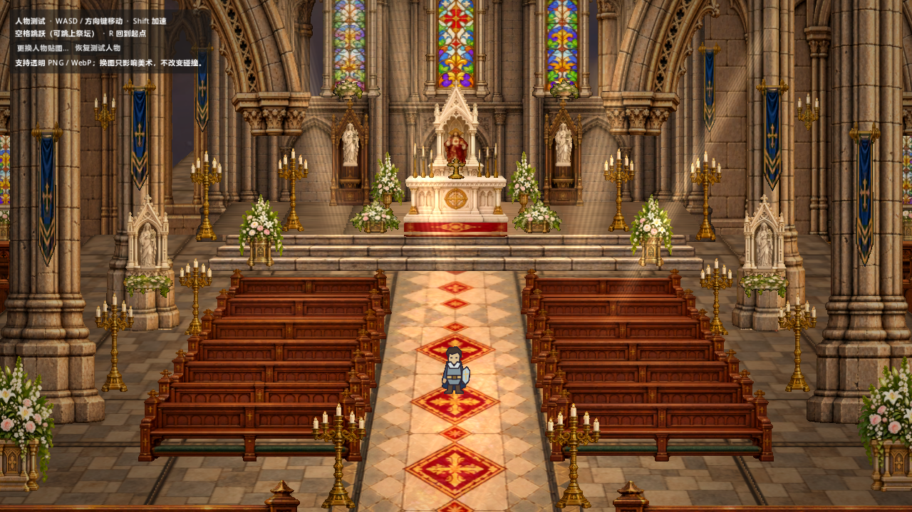

# HD-2D 教堂场景与人物测试

Godot 4.7.2 项目，使用 OpenGL Compatibility 渲染和 Jolt 3D 物理。

## 打开项目

在 Godot 项目管理器中导入本目录的 `project.godot`。首次打开需要等待素材导入完成，之后按 **F5** 运行。

## 内容

- 教堂场景：90 个独立素材实例，含墙体、彩窗、石柱、长椅、祭坛、烛台、旗帜及花艺。
- 通用场景元素模板：贴图、缩放、九宫格中心点、镜像、颜色及自动碰撞设置。
- 测试人物：移动、加速、跳跃、碰撞和运行时替换图片。
- 兼容渲染器下的光束、彩窗投影和轻微后期效果。

## 测试操作

WASD / 方向键移动，Shift 加速，空格跳跃，R 回到起点。左上角“更换人物贴图…”可选择电脑中的图片；运行时替换仅对本次测试有效。

永久更换人物：在 `scenes/main.tscn` 选中 `TestPlayer`，修改 `Character Texture`。

## 文件入口

- `scenes/main.tscn`：包含人物与测试面板的启动场景。
- `scenes/cathedral.tscn`：教堂场景，按元素类型分组。
- `scenes/scene_element.tscn`：通用元素模板。
- `scenes/test_player.tscn`：人物模板。
- `scenes/main_before_reference_20261026.tscn`：此前手动布局的备份。
- `docs/`：中文使用说明与渲染预览。

固定视角采用三维地面和二维立面素材；角色使用独立胶囊碰撞。当前角色为单张测试立绘，不包含多方向动画图集。台阶登高目前通过跳跃完成。

## 验证

```sh
godot --headless --path . --script res://tests/test_scene_element.gd
godot --headless --path . --script res://tests/test_cathedral.gd
godot --headless --path . --script res://tests/test_player.gd
```

`tools/build_cathedral.py` 可重建初始教堂布局；运行它会覆盖 `cathedral.tscn`，手动摆放后请先备份。


