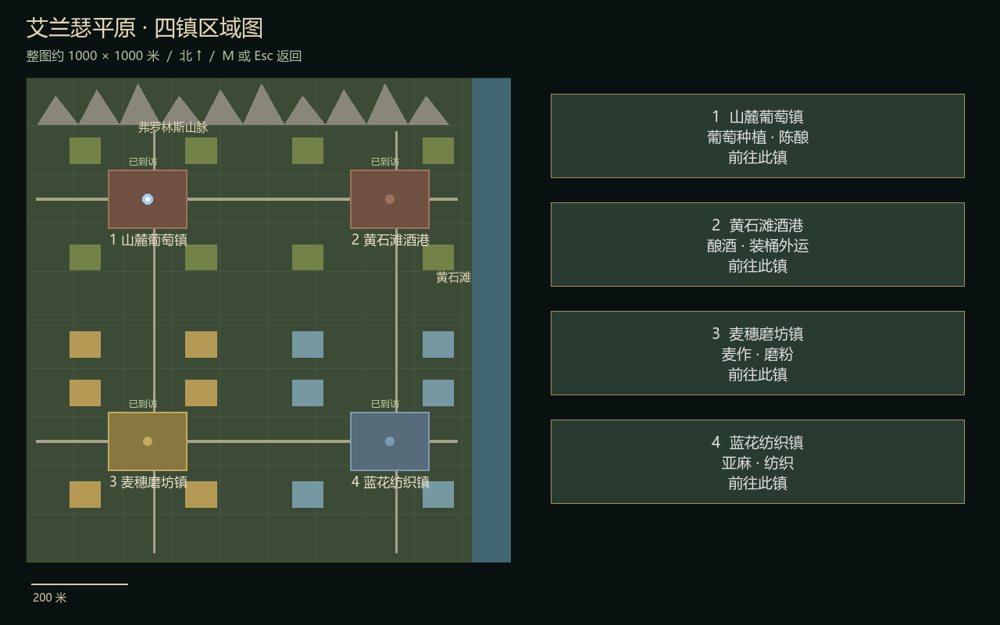
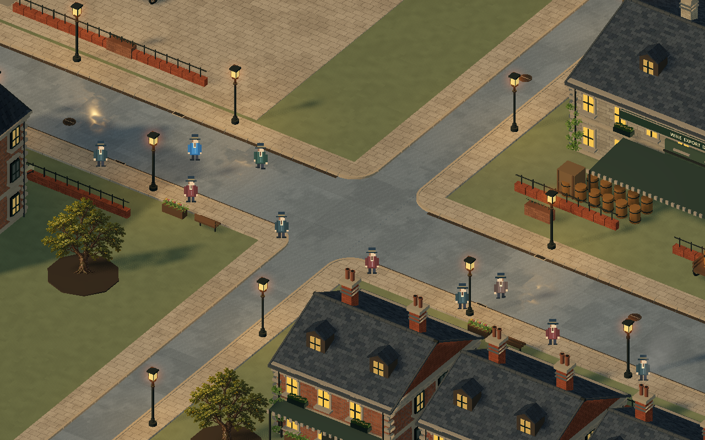

# 艾兰瑟大陆地图

当前版本：四镇平原 v10。此目录是可独立运行的 Godot 地图工程，尚未接入正式游戏菜单、战斗或存档。

2026-10-23。按用户选定的第一张明亮清晰风格继续制作；用户已确定其余两镇采用“麦作磨坊＋亚麻纺织”。本版针对房屋模型做像素材质与立面构件细化，并参考用户新提供的建筑图调整重点建筑轮廓。

## v10 道路素材整合（2026-10-23）
参考用户道路素材 `assets/reference_roads_v10.png`，以原生三维构件重建路缘与排水细节，没有把等距图直接铺在三维地面上。
- 每镇四处半径 2 米圆角人行道，移除横穿路口的旧铺面和路缘；圆角外侧补齐道路。
- 每镇 10 处排水格栅、3 处圆形井盖，以及沿主街的分段路缘和沟边石。
- 保留水泥主干道；人行道采用浅暖色错缝石板，64 像素/米材质采样，雨湿粗糙度变化与实际路灯反射。
- 四镇均在载入时应用 `roads_v10.gd`；直接打开旧烘焙 town_*.tscn 不包含运行时新增细节，请运行 world.tscn。
- 尺度仍为无比例尺条件下假定整图 1000×1000 米，1 Godot 单位=1米；非地理实测地图。
- 路缘、井盖与排水格栅为视觉构件，沿用连续地面碰撞和既有道路导航，不模拟高低台阶或地下排水。
验证：Godot 4.5.2 Forward+ 实机渲染，四镇通路/墙体/树木/水岸/山脉碰撞、交互、切换通过。新增近景 `world_roads.png`；结果见 `world_verification.json`。已知本机 user:// 着色器缓存目录权限警告不影响本次渲染。
原始素材由用户提供，项目保留来源文件；未作外部授权审计。
## 开始
用 Godot 4.5.2 导入 project.godot，按 F5；默认入口 world.tscn。
在原工作区也可运行 Run.ps1，它会使用相邻 .tools 下的 Godot 4.5.2。压缩包未捆绑引擎。

| 操作 | 功能 |
|---|---|
| WASD | 按镜头方向行走 |
| Shift | 快走 |
| F | 切换跟随视角 |
| 方向键、滚轮 | 平移、缩放 |
| Home | 当前城镇总览 |
| V | 朝街店面的商业街视角 |
| H | 房屋细节近景 |
| B | 北部山麓远景 |
| M | 四镇区域地图 |
| 地图上的按钮 / 数字 1–4 | 前往指定城镇 |
| E | 查看附近产业信息、关闭面板 |
| Esc | 关闭面板或地图 |
| P | 隐藏/显示界面 |

可从道路步行到另一镇，也可用区域地图旅行。接近下一镇 130 米范围时切换其详细街区，保留玩家的世界位置。当前镇载入详细几何，其余镇显示带双坡屋顶、烟囱和暖色窗户的简化远景；不代表四镇同时以最高细节渲染。

## 四镇分工
| 区域 | 世界中心 X,Z（米） | 产业表现 |
|---|---|---|
| 山麓葡萄镇 | -250,-250 | 葡萄藤、酒庄、橡木桶陈酿 |
| 黄石滩酒港 | 250,-250 | 酿酒、桶装仓储、集散外运 |
| 麦穗磨坊镇 | -250,250 | 麦田、粮袋、转动风车、磨粉与主粮 |
| 蓝花纺织镇 | 250,250 | 亚麻蓝花、晾布架、布包、纺织工坊 |

四镇共用砖石维多利亚建筑体系，每镇核心街区约 160×120 米、18 栋建筑；全图合计 72 处建筑布局记录。酿酒双镇复用相同核心布局，产业细节和地理环境承担主要差异。道路连接四镇，北部设置设计山体，东侧设置黄石滩岸线及浅水外观。

## 本轮变化
- 每镇 18 栋房屋换用专用像素砖石材质：64 texel/米的离散采样、五级砖色变化、错缝、边缘破损和轻微积灰；房屋采用五种砖色，仓库保留石墙。
- 每镇补绘 364 处侧墙、背墙及重点山墙窗：凹窗、分格木框、窗台、窗楣和托石。部分窗户使用暗玻璃，避免所有窗面亮度完全一致。
- 增加侧檐齿饰、转角石饰、落水管、窗下花箱、烟囱叠层和屋顶小窗分格；大部分零件按八种材质合并为网格。
- 商人楼改为四面折线屋顶，南北两侧添加装饰山墙；酒庄增加中央高山墙。保留原有建筑墙体碰撞，新增高处装饰不提供攀爬碰撞。
- H 键切到房屋近景；world_houses.png 为实际引擎截图。
- 保留 v4–v8 的地图、产业、葡萄架、远景、烟雾和交互。

## 资源与编辑
- world.tscn / world.gd：四镇世界、道路、海岸山体、加载和旅行。
- houses_logic.json：房屋数量、像素密度、重点屋顶和碰撞边界。
- houses_v9.gd / pixel_brick_v9.gdshader：房屋立面、重点屋顶及像素砖石材质；运行时生成在 PixelHousesV9。
- assets/reference_houses_v9.png：用户本轮建筑风格参考。
- vineyard_v8.gd / vineyard_logic.json：葡萄架替换、精灵尺寸、锚点和排列记录。
- assets/grape_trellis_v8.png：新葡萄架；assets/reference_atlas_v8.png：用户本轮参考图；同目录保存生成提示词。
- oak_door_v8.gdshader：酒窖木门材质。
- farfield_v7.gd / farfield_logic.json：连续山脊、实际高度采样、碰撞约定及远景城镇。
- roof_logic.json：屋顶尺度、烟管数量与烟雾参数。
- roof_v6.gd / slate_v6.gdshader：独立坡面、局部板岩和屋顶构件。
- smoke_v6.gd / smoke_v6.gdshader：轻量程序烟雾；仅当前详细镇运行。
- street_logic.json：新增店面归属、朝向约定及装饰/碰撞边界。
- street_v5.gd：朝街店面、细叶簇与庭院装饰，运行时挂载于 StreetDetailsV5。
- landscape_v4.gd：农田地块、树木替换与港口设施；terrain.gdshader / water.gdshader：地面和水面材质。
- assets/elm_tree_v4.png：本轮 AI 生成的透明榆树资源；同目录保存生成提示词。
- regions.json：四镇中心、产业与资源映射。
- regional_map.gd：可操作区域地图。
- town_editable.tscn：葡萄酒街区静态资源，两座酿酒镇共享。
- town_wheat.tscn / town_flax.tscn：磨坊镇与纺织镇静态资源。
- main.tscn / town.gd / details.gd：原样区生成器及细节源代码。
- restore_instances.gd：实例化植被的可持久化位置与颜色。
- landscape_logic.json：v4 树木尺度、货台与新增碰撞设施记录。
- world_logic.json：全局建筑 ID、世界位置、四镇定义、道路导航顶点/多边形、海岸阻挡及角色尺寸。
- world_verification.json：本版四镇实际运行验证结果。
- world_foothill.png / world_shore.png / world_grain.png / world_linen.png / world_map.png：引擎实拍预览；world_harbor.png / world_countryside.png 为新增港口与镇外道路实拍。
旧版 engine_*.png、layout.json、logic.json、verification.json 是单样区输出，不是四镇验收依据；交付压缩包仅保留本版 world_* 验证与预览，源代码仍可重建样区数据。
本地 history/v1、history/v2、history/v3、history/v4、history/v5、history/v6、history/v7、history/v8 保留旧版文件，不随压缩包交付。

静态街区资源可直接在编辑器查看和调整。v4–v9 的树木替换、农田、酒港、店面、屋顶、远景、葡萄架与房屋细节通过 world.gd 在运行时生成，F5 查看完整效果；单独打开旧静态资源仍会看到原树冠。四镇运行时会移除街区资源自带的相机、环境与局部导航，由 world.gd 统一控制。重新烘存会覆盖对应静态资源，手工修改请另存副本。风车转动由四镇世界脚本驱动。

## 验证范围
通过真实 Forward+ 运行检查各镇：墙体角色碰撞、入口胶囊通行、产业 Area3D 触发、到下一镇的导航路径及沿线胶囊扫掠。额外检查地图按钮、键盘打开地图和数字键返回、四镇到访计数、步行接近时位置保持、植被实例数量与首个实例位置恢复。
地图、麦田、亚麻田、人物和主要设施已目视检查实际引擎截图。
这不是长期性能基准或完整人工漫游验收。导航覆盖连接道路，不覆盖农田、货场内部或室内；居民不与玩家及彼此互相阻挡。海面不可游泳，岸外有阻挡；部分装饰性细柱、树木和长椅没有精确碰撞。
工具沙箱无法写默认 user:// Vulkan / shader 缓存目录，运行日志仍记录缓存创建警告；已成功运行和输出图像，首次着色器编译可能较慢。

## 比例、来源与完成边界
整图 1000×1000 米是用户指定的假设，参考图没有地理配准、比例尺或 DEM。地图是虚构设计，无 EPSG。源平面西南为 (0,0)，Godot X=E-500、Y=设计高度、Z=500-N；1 单位=1 米，平原基准 Y=0，垂直夸张 1。
四镇位置、山体、海岸和交通线是本次设计，不能视为从原图精确提取的地理数据。

本版达到四镇可探索原型阶段，仍明显简化于首张美术概念图。农田作物和港口设施仍为简化几何，远镇仍使用简化几何，详细街区按 130 米范围切换，尚未实现渐变过渡，两座酒镇核心布局相似，建筑室内、完整物流/交易、马车动画、精细海岸与山体、存档和长期性能优化尚未完成。访问记录仅在当前运行中保留。

美术依据来自用户文字与参考图；代码、程序几何、材质和简易人物均在项目内生成，未加入第三方美术资产包。榆树由本轮内置 ImageGen 根据文字生成，原图保留于工作区外的 generated_images，交付包包含复制的 PNG 和提示词；其风格依据用户首张参考图。MultiMesh 接口核对来自 Godot 官方文档：https://docs.godotengine.org/en/4.5/classes/class_multimesh.html

## 复现
四镇验证：./Run.ps1 -Verify
四镇纯逻辑验证：./Run.ps1 -Verify -Headless
原样区：./Run.ps1 -Sample
原样区验证：./Run.ps1 -Sample -Verify
重新生成三种街区时，通过 Godot 启动 main.tscn，用户参数传入 --verify --district=wine（或 wheat / flax）。

树木精灵接口参考：https://docs.godotengine.org/en/4.5/classes/class_spritebase3d.html

屋顶及烟雾接口参考： https://docs.godotengine.org/en/4.5/classes/class_surfacetool.html 和 https://docs.godotengine.org/en/4.5/tutorials/shaders/shader_reference/spatial_shader.html 。烟雾为程序化透明平面，不是体积流体模拟；屋顶未提供攀爬或站立碰撞。

本轮仅把葡萄架和酒窖门作为素材风格落地样区，并未逐格重建整张素材图。葡萄架为二维平面精灵，从侧面观察会变薄；当前无葡萄采收交互或田间导航。

本轮细化的是三维模型的轮廓、材质和装饰构件，没有将整栋房屋换成静态图片。与参考图的手绘笔触、精细雕花和丰富植被仍有差距；远景简化模型不包含全部近景细节。
